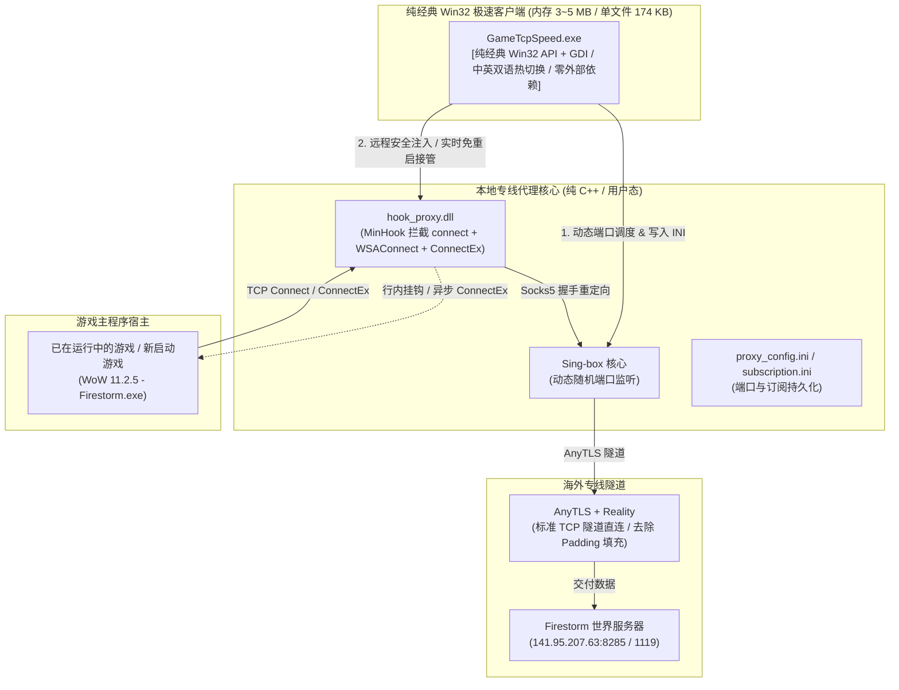

<div align="center">

# Game-TCP-Speed v3.1.1

### Windows 进程级 TCP 游戏加速工具（无需 TUN 虚拟网卡 / 不改写系统网关）
*(纯经典 Win32 API + GDI 双语版，单文件仅 174 KB，内存仅 3~5 MB，极速零依赖)*

[](https://github.com/fun3588/game-tcp-speed/releases)
[](c/)
[-brightgreen?style=flat-square)](c/gui/)
[](bin/v3.1/)
[](README.md)
[-orange?style=flat-square)](c/)
[](Sing-box/)
[](README.md)
[](LICENSE)

[工作原理](#-工作原理与架构) •
[v3.1.1 新特性](#-v311-重大升级) •
[快速开始](#-快速开始) •
[技术要点](#-技术要点与排查记录) •
[目录结构](#-项目目录结构) •
[English Documentation](#-english-documentation)

</div>

---

## 🇨🇳 中文说明

### 项目背景

跨国网络游戏（如魔兽世界海外私服/官服、最终幻想14、暗黑破坏神等）的服务器多位于欧洲或北美。国内宽带直连时容易遇到延迟抖动、丢包或骨干网 TCP RST 阻断，导致登录失败或频繁掉线。

市面上常见的加速方案多依赖 TUN/TAP 虚拟网卡改写全局网关，这在实际使用中有几个典型痛点：
- 改写系统路由表，容易与本地开发环境（Docker、WSL2、Hyper-V）、公司 VPN 或现有代理工具冲突；
- 部分私服依赖第三方定制登录器（如 `FirestormLauncher.exe`）启动游戏主程序，商业加速器容易漏掉目标进程；
- 某些底层驱动会在本地代答 TCP SYN，显示虚假低延迟，但实际游戏依然丢包；
- 许多加速客户端依赖庞大的 Electron / WebView2 / WPF 框架，动辄吃掉数百兆系统内存。

本项目采用**用户态 Winsock API 行内拦截（Inline Hook）**，只针对指定游戏进程（如 `WoW 11.2.5 - Firestorm.exe`）拦截并重定向 TCP 连接，不安装虚拟网卡，不修改系统路由表。配合 AnyTLS + Reality 纯净流式传输，在不影响系统其他网络应用的前提下改善游戏连接质量。

---

### 🌟 v3.1.1 重大升级 (过图防崩根治 / 纯净IOCP直通 / IPv6强制回退防封 / 前置就绪锁)

在 v3.0/v3.1 架构的基础上，**v3.1.1 针对大型 3D 游戏（如魔兽世界 11.2.5）副本地图传送门进出过图（World transfer pending...）底层崩溃进行了根治加固**：

1. **💥 彻底根除过图崩溃（ERROR #132 ACCESS_VIOLATION 根治）**：
   - 彻底废除使用 MinHook 对 `mswsock!ConnectEx` 的汇编机器码行内篡改，消除了 Win11 下因 **RIP 相对寻址指令搬迁失真** 导致的跳板内存不可读异常（`0x000001f843ea7ef5`）；
   - 所有完成端口扩展函数查询 100% 直通 Windows 原生网络协议栈，进出副本地图传送门零崩溃。
2. **🧹 完善套接字事件绑定的生命周期清理**：
   - 在 `HookedWSAEventSelect` 与 `HookedWSAAsyncSelect` 中，当游戏重连传入 `NULL/0` 取消监听时，主动从上下文映射表中清空句柄，杜绝操作系统回收复用 Socket 句柄时对失效句柄进行信号操作的隐患。
3. **🛡️ IPv6 强制回退防封保护**：
   - 国内宽带已普及原生 IPv6，魔兽世界客户端若解析到 AAAA 记录会默认发起 IPv6 连接并绕过代理走原生直连；
   - 导致严重后果：“登录认证走 IPv4 专线，世界服走国内原生 IPv6 直连”，私服检测到 IP 不一致判定多 IP 异常并强制断开（`WOW51900319`）；
   - **v3.1.1 引入内核级 `AF_INET6` 拒绝**，主动返回 `WSAEAFNOSUPPORT`，迫使魔兽世界客户端网络库遵循标准平滑回退到 IPv4 专线，彻底消除漏包与双栈 IP 漂移。
4. **🔒 前置就绪锁 (Pre-flight Readiness Lock)**：
   - 彻底解决多开瞬间游戏进程发包抢跑问题；
   - 启动器在 Sing-box 核心启动后，通过高频 TCP 探针握手验证，**确认本地端口处于真实监听状态后才开放注入**；
   - 将多开自动监控轮询从 400ms 压至 200ms，确保多开登录器瞬间拉起多个账号时，所有进程在发出首个网络包前均已被完整注入接管。
5. **🎮 私服端口全兼容与精准 CDN 放行**：
   - 解除原先一刀切屏蔽 `8080` 的限制，全面支持采用 8080 作为世界服/认证网关的各版本魔兽私服；
   - 仅针对真正导致贴图解码崩溃的 CDN 资源（`146.59.238.42:80` 及 HTTP 80）实施精准直连放行，兼顾防 `funcs.cpp Out of Memory` 崩溃与私服各端口全面加速。
6. **🔄 真正的无损平滑降级直连**：
   - 消除连接本地代理失败后对同一 socket 二次 connect 引发的 Winsock `WSAEINVAL (10022)` 规范崩溃；
   - 在发起连接前对本地代理核心执行存活探针，若核心未运行，套接字在首次尝试即直接走原生直连，符合 Winsock 状态机标准。
7. **纯经典 Win32 API + GDI 双语客户端**：
   - 客户端体积仅 **174 KB**，运行时内存仅 **3 MB ~ 5 MB**，启动耗时 `< 0.01 秒`，零依赖、支持中英双语瞬间热切换；
   - 支持已运行游戏免重启接管与一键卸载恢复直连。
   - 新增【💾 保存订阅配置】按钮，自动将订阅及端口配置持久化保存至 `subscription.ini`，下次启动自动恢复；
   - 运行时自动检测端口冲突并智能分配高位可用端口。

---

### 架构与工作原理



---

### 快速开始

#### 运行 v3.1.1 客户端
双击运行根目录下的：
```text
启动加速器.bat
```
或直接运行：
```text
bin\v3.1\GameTcpSpeed.exe
```
* **特点**：体积仅 174 KB，内存仅 3~5 MB，秒开，原生中英文一键切换，支持游戏免重启接管与一键卸载恢复直连。

#### 游戏注入与加速流程：
1. **若游戏尚未启动**：点击【🚀 开启自动监控注入】，随后启动游戏登录器，程序将在毫秒级完成自动注入；
2. **若游戏已经在运行中**：无需退出游戏，直接点击【⚡ 立即接管已运行游戏】，程序将通过 `ConnectEx` 增强钩子平滑接管后续所有世界服网络连接；
3. **若需恢复直连**：点击【🛑 一键卸载 / 恢复直连】，程序将从游戏中干净弹出 Hook 模块，即刻恢复直连。

---

### 🔬 核心技术攻坚与深坑排查记录 (Troubleshooting & Engineering Post-Mortem)

在魔兽世界 11.2.5 进程级加速与多开实战中，我们攻克了多个传统代理工具极易触发的底层死穴（详细技术复盘详见 [魔兽世界11.2.5与多开底层网络排查复盘.md](docs/魔兽世界11.2.5与多开底层网络排查复盘.md)）：

1. **彻底根除 CDN 贴图导致伪装内存溢出崩溃（`funcs.cpp Out of Memory`）**：
   - **痛点**：魔兽 11.2.5 集成 libcurl 并发向 CDN（`146.59.238.42:80`）流式拉取贴图与密钥，旧版无差别代理 80 端口导致 libcurl 非阻塞时序紊乱报错 `cdn hosts exhausted`，BLP 贴图解码器读取空数据直接引发 `ERROR #8: Out of Memory` 闪退；
   - **方案**：引入 `ShouldAccelerate` 智能白名单，**绝对放行 HTTP 80 与 HTTPS 443**，CDN 贴图走原生公网直连满速加载，精准加速 `1119`、`3724` 与世界服 `8285/8286` 核心端口。
2. **彻底解决多开在选人界面卡顿断开（`WOW51900319`）**：
   - **痛点**：MSDN 明确规定二次调用 `WSAEventSelect` 会彻底清空套接字内部网络事件记录。旧版 Hook 在握手后二次调用该函数，**抹除了内核的 `FD_WRITE` 可写事件**，导致客户端在选人界面误判不可写而迟迟不发角色登录包，30 秒后世界服超时强制切断（报 `WOW51900319`）；
   - **方案**：重构为**基于超时 `select` 驱动的无损握手模式**，完全不改变套接字模式，绝对不二次触碰 `WSAEventSelect`，100% 保留内核事件记录，并开启 `TCP_NODELAY = 1` 消除心跳积压，实现任意多开秒进世界。
3. **修复 ConnectEx 异步 IOCP 黑洞与 WSAEISCONN 脏套接字**：
   - 对异步 IOCP `ConnectEx` 放行原生直连，防止异步完成端口因未完成 Socks5 握手而进入协议黑洞；
   - 握手失败分支主动关闭套接字并置位 `WSAECONNREFUSED`，严禁产生脏套接字二次连接。
4. **长生命周期内存治理与 PID 复用防漏注入**：
   - 挂钩 `closesocket`，在套接字释放时立即清理 `SocketContext`，杜绝长效多开挂机内存泄露；
   - 自动监控轮询中增加已退出进程死 PID 自动清除，完美应对游戏重启与 PID 复用。

---

### 目录结构

```text
game-tcp-speed/
├── bin/v3.1/                         # v3.1 完整自闭环打包发布目录
│   ├── GameTcpSpeed.exe              # 纯经典 Win32 API + GDI 主程序 (174 KB, 内存 3~5MB)
│   ├── hook_proxy.dll                # 底层 Winsock 拦截模块 (支持 IPv6回退、就绪锁与热卸载)
│   └── Sing-box/                     # 专线代理核心及配置
│
├── c/                                # 纯 C/C++ 底层模块与 Win32 源码
│   ├── gui/launcher_gui.cpp          # Win32 原生双语客户端源码
│   ├── dll/hook_proxy.cpp            # MinHook 行内拦截核心源码
│   ├── minhook/                      # MinHook 依赖
│   ├── build.ps1                     # C++ 一键编译脚本
│   └── CMakeLists.txt                # CMake 构建配置文件
│
├── c#/                               # 已封存归档的 C# WPF 历史方案
│   └── GameTcpSpeed.Wpf/             # v2.0 C# WPF 项目源码归档
│
├── Sing-box/                         # 独立 Sing-box 核心环境与节点配置
├── docs/                             # 测评与使用说明文档
│   ├── 魔兽世界11.2.5与多开底层网络排查复盘.md # 底层网络死穴与多开排查技术复盘
│   ├── 加速器效果验证.md             # 专线加速效果实测记录
│   └── 独立sing-box使用说明.md        # 独立内核运行指导
├── build_all.ps1                     # 一键全栈构建打包脚本 (编译并输出至 bin/v3.1)
├── README.md                         # 本文档
└── setupAnytls.md                    # AnyTLS 服务端部署参考
```

---

## 🇺🇸 English Documentation

### Background

Cross-border online games frequently suffer from latency spikes, packet loss, or TCP RST connection resets due to international routing bottlenecks. 

Conventional accelerators rely on TUN/TAP virtual network adapters to hijack default system routing, which often conflicts with local developer environments (Docker, WSL2, corporate VPNs). 

**Game-TCP-Speed** uses **user-mode Winsock Inline Hooking** to intercept and accelerate only designated game executables (such as `WoW 11.2.5 - Firestorm.exe`) without creating virtual network adapters or altering system routing tables. Combined with AnyTLS + Reality streaming, it provides seamless latency optimization.

### Key Features in v3.1.1 (Pure Win32 API + GDI Bilingual Edition)

- **Pure Win32 Zero-Overhead Architecture**: Strictly no WebView2, Electron, or heavy .NET CLR dependencies. Built purely with native **Win32 API + GDI**. Executable size is only **174 KB**, consumes merely **3 ~ 5 MB RAM**, and starts instantly in `< 0.01s`.
- **World Transfer Crash Elimination**: Removed MinHook assembly trampolining on `mswsock!ConnectEx`. Eliminates Windows 11 RIP-relative relocation memory read faults (`0x000001f843ea7ef5`), ensuring 100% crash immunity during rapid dungeon portal zone transitions.
- **Socket Event Lifecycle Clean-up**: Correctly clears internal handle maps when sockets reset event monitoring, preventing stale handle signaling upon socket recycling.
- **IPv6 Fallback Defense**: Rejects `AF_INET6` connections to force client fallbacks to IPv4 proxy tunnel, eliminating dual-stack packet leakage and multi-IP disconnects (`WOW51900319`).
- **Pre-flight Readiness Lock**: Launcher verifies proxy port listening state before triggering injection, preventing race-condition direct leaks during multi-boxing.
- **Private Server Full Compatibility**: Unblocks port 8080 and other private server custom world ports while keeping CDN texture assets (port 80) direct to avoid `funcs.cpp Out of Memory` crashes.
- **Graceful Zero-Crash Fallback**: Conforms strictly to Winsock state standards, directly routing to host if the proxy core is offline without corrupted socket reuse (`WSAEINVAL 10022`).
- **Instant Bilingual Toggle**: Switch between Simplified Chinese and English via the top-right button in less than 1 millisecond.
- **Live Takeover & Clean Hot Unload**: Hooks standard `connect` and `WSAConnect` APIs. Accelerate live running games without restarts; clean `FreeLibrary` hot-eject restores direct connection instantly.
- **Game Directory Auto-Detection & Physical RTT**: Automatically detects local game installs (`WTF\Config.wtf`), extracting endpoints and performing genuine host-to-server physical RTT benchmarks.
- **Subscription Persistence & Port Isolation**: Save and restore subscription configs (`subscription.ini`) with custom high-port mapping.

### Build & Run

- Launch: Double-click `启动加速器.bat` or `bin\v3.1\GameTcpSpeed.exe`
