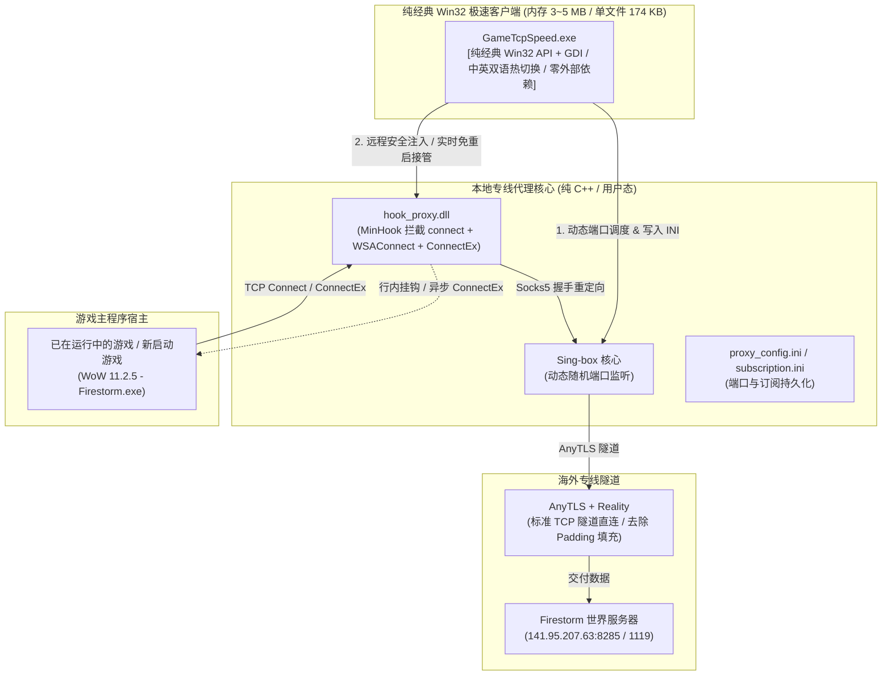

<div align="center">

# Game-TCP-Speed v3.0

### Windows 进程级 TCP 游戏加速工具（无需 TUN 虚拟网卡 / 不改写系统网关）
*(纯经典 Win32 API + GDI 双语版，单文件仅 174 KB，内存仅 3~5 MB，极速零依赖)*

[](https://github.com/fun3588/game-tcp-speed/releases)
[](c/)
[-brightgreen?style=flat-square)](c/gui/)
[](bin/v3.0/)
[](README.md)
[-orange?style=flat-square)](c/)
[](Sing-box/)
[](README.md)
[](LICENSE)

[工作原理](#-工作原理与架构) •
[v3.0 新特性](#-v30-重大升级) •
[快速开始](#-快速开始) •
[技术要点](#-技术要点与排查记录) •
[目录结构](#-项目目录结构) •
[English Documentation](#-english-documentation)

</div>

---

## 🇨🇳 中文说明

### 项目背景

跨国网络游戏（如魔兽世界海外私服/官服、最终幻想14、暗黑破坏神等）的服务器多位于欧洲或北美。国内宽带直连时容易遇到延迟抖动、丢包或骨干网 TCP RST 阻断，导致登录失败或频繁掉线。

市面上常见的加速方案多依赖 TUN/TAP 虚拟网卡改写全局网关，这在实际使用中有几个典型痛点：
- 改写系统路由表，容易与本地开发环境（Docker、WSL2、Hyper-V）、公司 VPN 或现有代理工具冲突；
- 部分私服依赖第三方定制登录器（如 `FirestormLauncher.exe`）启动游戏主程序，商业加速器容易漏掉目标进程；
- 某些底层驱动会在本地代答 TCP SYN，显示虚假低延迟，但实际游戏依然丢包；
- 许多加速客户端依赖庞大的 Electron / WebView2 / WPF 框架，动辄吃掉数百兆系统内存。

本项目采用**用户态 Winsock API 行内拦截（Inline Hook）**，只针对指定游戏进程（如 `WoW 11.2.5 - Firestorm.exe`）拦截并重定向 TCP 连接，不安装虚拟网卡，不修改系统路由表。配合 AnyTLS + Reality 纯净流式传输，在不影响系统其他网络应用的前提下改善游戏连接质量。

---

### 🌟 v3.0 重大升级 (纯经典 Win32 API + GDI 双语版)

**v3.0 全面确立纯经典 Win32 API + GDI 架构为唯一官方版本**，追求极致微型与极致响应速度：

1. **极致轻量、零运行时依赖**：
   - 彻底摒弃一切重型 Web 框架与托管运行时，客户端采用**纯原生 Win32 API + GDI**；
   - 程序单文件仅 **174 KB**，运行时内存仅 **3 MB ~ 5 MB**，启动耗时 `< 0.01 秒`（瞬间打开）；
   - 零依赖：任意 Windows 10/11 纯净系统双击即开，不需要显卡高级 3D 渲染支持，不需要安装任何外部运行库；
   - 原 C# WPF 版本已完整封存归档于 [`c#/GameTcpSpeed.Wpf/`](c#/GameTcpSpeed.Wpf/) 目录下。
2. **原生中英双语即时一键热切换**：
   - 窗口右上角提供原生 `[ 🇨🇳 简体中文 / 🇺🇸 English ]` 切换按钮；
   - 点击瞬间刷新所有选项卡标签、分组框、按钮、输入框、数据表头与状态诊断，**耗时 < 1 毫秒**。
3. **免重启平滑接管与一键干净热卸载**：
   - 深度拦截标准 `connect`、`WSAConnect` 以及异步完成端口 `ConnectEx`（微软扩展函数）；
   - 游戏已在运行中（选人界面或世界服中）亦可直接点击【⚡ 立即接管已运行游戏】，平滑切入专线，**无需退出游戏**；
   - 新增【🛑 一键卸载 / 恢复直连】，远程线程调用 `FreeLibrary` 干净弹出 Hook 模块并解除拦截，游戏 100% 即刻恢复原本物理直连。
4. **游戏配置探测与真实物理直连测速**：
   - 自动探测本地游戏安装目录（如 `The War Within\WTF\Config.wtf`），解析出 `portal`（EU）并提取端点；
   - 全面测试看板直观展示主机到海外各服务器的**真实物理连通性与 RTT**，杜绝虚假代答。
5. **订阅持久化与自定义端口调度**：
   - 支持自研 JSON 订阅与通用 Base64 订阅；
   - 新增【💾 保存订阅配置】按钮，自动将订阅及端口配置持久化保存至 `subscription.ini`，下次启动自动恢复；
   - 运行时自动检测端口冲突并智能分配高位可用端口。

---

### 架构与工作原理



---

### 快速开始

#### 运行 v3.0 客户端
双击运行：
```text
bin\v3.0\GameTcpSpeed.exe
```
* **特点**：体积仅 174 KB，内存仅 3~5 MB，秒开，原生中英文一键切换，支持游戏免重启接管与一键卸载恢复直连。

#### 游戏注入与加速流程：
1. **若游戏尚未启动**：点击【🚀 开启自动监控注入】，随后启动游戏登录器，程序将在毫秒级完成自动注入；
2. **若游戏已经在运行中**：无需退出游戏，直接点击【⚡ 立即接管已运行游戏】，程序将通过 `ConnectEx` 增强钩子平滑接管后续所有世界服网络连接；
3. **若需恢复直连**：点击【🛑 一键卸载 / 恢复直连】，程序将从游戏中干净弹出 Hook 模块，即刻恢复直连。

---

### 目录结构

```text
game-tcp-speed/
├── bin/v3.0/                         # v3.0 完整自闭环打包发布目录
│   ├── GameTcpSpeed.exe              # 纯经典 Win32 API + GDI 主程序 (174 KB, 内存 3~5MB)
│   ├── hook_proxy.dll                # 底层 Winsock 拦截模块 (支持 ConnectEx 与热卸载)
│   └── Sing-box/                     # 专线代理核心及配置
│
├── c/                                # 纯 C/C++ 底层模块与 Win32 源码
│   ├── gui/launcher_gui.cpp          # Win32 原生双语客户端源码
│   ├── dll/hook_proxy.cpp            # MinHook 行内拦截核心源码
│   ├── minhook/                      # MinHook 依赖
│   ├── build.ps1                     # C++ 一键编译脚本
│   └── CMakeLists.txt                # CMake 构建配置文件
│
├── c#/                               # 已封存归档的 C# WPF 历史方案
│   └── GameTcpSpeed.Wpf/             # v2.0 C# WPF 项目源码归档
│
├── Sing-box/                         # 独立 Sing-box 核心环境与节点配置
├── docs/                             # 测评与使用说明文档
├── build_all.ps1                     # 一键全栈构建打包脚本 (编译并输出至 bin/v3.0)
├── README.md                         # 本文档
└── setupAnytls.md                    # AnyTLS 服务端部署参考
```

---

## 🇺🇸 English Documentation

### Background

Cross-border online games frequently suffer from latency spikes, packet loss, or TCP RST connection resets due to international routing bottlenecks. 

Conventional accelerators rely on TUN/TAP virtual network adapters to hijack default system routing, which often conflicts with local developer environments (Docker, WSL2, corporate VPNs). 

**Game-TCP-Speed** uses **user-mode Winsock Inline Hooking** to intercept and accelerate only designated game executables (such as `WoW 11.2.5 - Firestorm.exe`) without creating virtual network adapters or altering system routing tables. Combined with AnyTLS + Reality streaming, it provides seamless latency optimization.

### Key Features in v3.0 (Pure Win32 API + GDI Bilingual Edition)

- **Pure Win32 Zero-Overhead Architecture**: Strictly no WebView2, Electron, or heavy .NET CLR dependencies. Built purely with native **Win32 API + GDI**. Executable size is only **174 KB**, consumes merely **3 ~ 5 MB RAM**, and starts instantly in `< 0.01s`.
- **Archived C# Implementation**: Legacy WPF client is cleanly archived under [`c#/GameTcpSpeed.Wpf/`](c#/GameTcpSpeed.Wpf/).
- **Instant Bilingual Toggle**: Switch between Simplified Chinese and English via the top-right button in less than 1 millisecond.
- **Live Takeover & Clean Hot Unload**: Hooks standard `connect`, `WSAConnect`, and asynchronous IOCP `ConnectEx` APIs. Accelerate live running games without restarts; clean `FreeLibrary` hot-eject restores direct connection instantly.
- **Game Directory Auto-Detection & Physical RTT**: Automatically detects local game installs (`WTF\Config.wtf`), extracting endpoints and performing genuine host-to-server physical RTT benchmarks.
- **Subscription Persistence & Port Isolation**: Save and restore subscription configs (`subscription.ini`) with custom high-port mapping.
- **Graceful Auto-Bypass**: Automatically degrades to direct connection when the proxy core is offline.

### Build & Run

- Launch: `bin\v3.0\GameTcpSpeed.exe`
