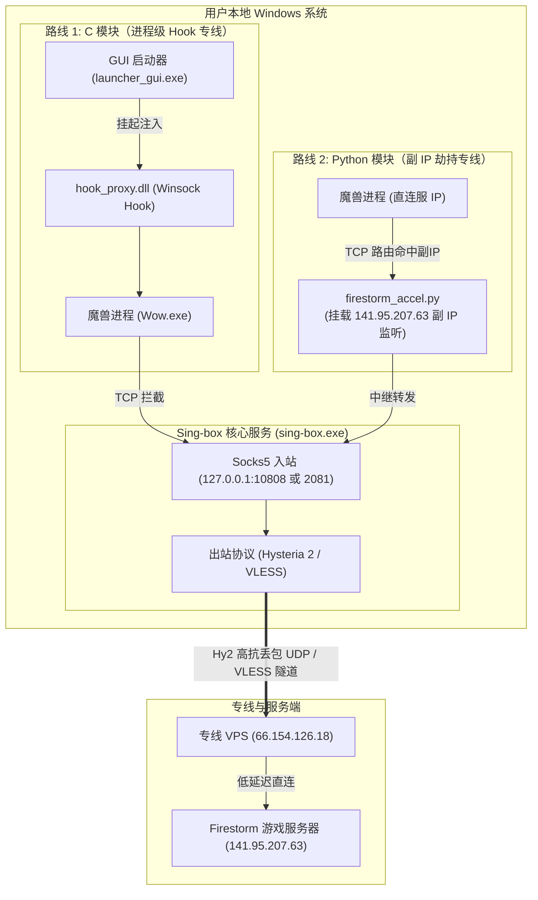

# game-tcp-speed

针对特定进程 / 特定服务器 IP 的 TCP 游戏加速方案。
（目标场景：Firestorm 私服魔兽 —— 游戏服务器 `141.95.207.63`）

## 目录

```
game-tcp-speed/
├─ py/                      自制加速器（副 IP 劫持 + 用户态 SOCKS5 中继）
│   ├─ firestorm_accel.py      主程序
│   ├─ run_accel.cmd           走 Throne(2080) 启动
│   ├─ run_accel_singbox.cmd   走独立 sing-box(2081) 启动
│   ├─ stop_accel.cmd          停止并摘除副 IP
│   └─ firestorm_accel.log     运行日志
├─ Sing-box/                独立 sing-box 实例（与 Throne 完全隔离）
│   ├─ sing-box.exe            核心
│   ├─ config.json             可用配置（带注释，双节点可选）
│   ├─ config.template.json    空白模板（占位符版，供参考）
│   ├─ run-singbox.cmd         启动
│   ├─ stop-singbox.cmd        停止
│   ├─ switch-node.cmd         热切换节点 hy2 / vless
│   └─ singbox.log             运行日志
├─ c/                       底层注入与 Winsock Hook DLL + Win32 GUI 启动器（已完成）
│   ├─ dll/hook_proxy.cpp      Winsock connect Hook 核心
│   ├─ gui/launcher_gui.cpp    Win32 原生控制界面与挂起注入器
│   ├─ minhook/                MinHook 源码
│   ├─ build.bat / build.ps1   一键编译脚本
│   └─ README.md               详细架构与时序文档
├─ bin/                     编译产物 (hook_proxy.dll, launcher_gui.exe)
└─ docs/                    文档

```

## 两条独立链路

| | 代理出口 | 用途 |
|---|---|---|
| 原有链路 | Throne `127.0.0.1:2080` | 日常上网代理，顺带被加速器借用 |
| 独立链路 | 独立 sing-box `127.0.0.1:2081` | 专供游戏加速，与 Throne 互不干扰 |

两条链路连的是同一台服务器（`66.154.126.18`），所以**共享账号流量额度**，
但进程、配置、路由完全独立 —— Throne 退出 / 切节点 / 开 TUN 都不影响游戏加速。

## 快速开始

```
1) Sing-box\run-singbox.cmd          独立 sing-box（常驻，最小化即可）
2) py\run_accel_singbox.cmd          加速器（需管理员，走 2081）
   ...进游戏...
3) 关掉加速器窗口（或 py\stop_accel.cmd）→ 摘除副 IP，恢复直连
4) Sing-box\stop-singbox.cmd         停掉 sing-box
```

想用回 Throne：把第 2 步换成 `py\run_accel.cmd` 即可。

## 原理

加速器不改 hosts、不用 TUN、不注入进程：

1. `netsh interface ipv4 add address <iface> 141.95.207.63 255.255.255.255`
   —— 把游戏服务器 IP 作为「副 IP」挂到本机回环伪接口上。
2. 在该 IP 的 `1119 / 3724 / 8085 / 8086 / 8285 / 8286` 端口监听。
3. 游戏发往 `141.95.207.63` 的 TCP 连接被操作系统投递到本机（源 IP == 目的 IP），
   中继再经 SOCKS5 交给代理节点，由节点侧发起真实连接。
4. 退出时 `netsh ... delete address` 摘除副 IP，系统完全复原。

## 实测数据

见 `docs/` 下的验证报告。要点：

- 加速前直连：avg 577ms / 抖动 σ 344 / 最差 1483ms
- 加速后隧道：avg 485ms / 抖动 σ 139 / 最差 904ms
- 独立 sing-box 两实例对比 Throne：抖动均更低（Throne 同时承载游戏流量）

## 注意

- 加速器和 sing-box 的**副 IP / 路由修改需要管理员权限**。
- 副 IP 只劫持 **TCP**；UDP 流量不过隧道。
- 开启期间本机访问 `141.95.207.63` 一律被劫持，必须用 `stop_accel.cmd` 清理。
## 架构图


