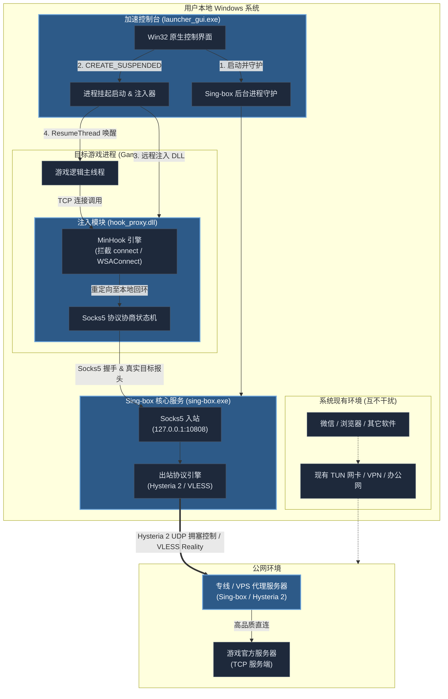
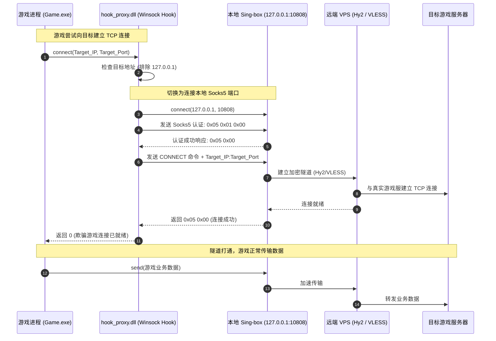

# C 模块：TCP 游戏专线加速套件

本目录包含了基于 **Winsock API Hook** 的进程级 TCP 流量拦截动态库（DLL）以及轻量级 Win32 原生 GUI 注入启动器。

---

## 架构优势与设计思想

1. **零网卡冲突（非 TUN 方案）**：
   - 很多开发者在系统已开启 Clash / VPN / 远程办公网卡时，再开 TUN 会抢占默认网关 `0.0.0.0/0` 导致网络瘫痪。
   - 本项目通过 **进程内存级 Hook** 仅拦截目标游戏进程的 TCP 连接，**完全不碰系统路由表与虚拟网卡**，与系统上其他任何网络/TUN 软件完美共存。
2. **纯 TCP 极简高效**：
   - 绝大多数大型端游的协议通信均为 TCP 流。
   - 本套件拦截 `connect` 与 `WSAConnect`，瞬间完成 Socks5 握手并转接给本地 Sing-box，无任何封包转换损耗，延迟与直连隧道一致。
3. **首包不丢（挂起注入模式）**：
   - 采用 Windows 进程创建的挂起模式（`CREATE_SUSPENDED`），在游戏代码尚未执行任何网络连接前将 DLL 注入，确保游戏发送的第一个账号登录包就能被 100% 拦截并走加速节点。

---

## 架构图

### 1. 系统拓扑与隔离架构



### 2. TCP 连接劫持与加速时序图



---

## 目录结构

```text
c/
├── dll/
│   └── hook_proxy.cpp      # 拦截 connect/WSAConnect 并执行 Socks5 握手的 DLL 源码
├── gui/
│   └── launcher_gui.cpp    # 原生 Win32 启动器，管理 Sing-box 与游戏进程注入
├── minhook/                # 轻量级开源 API Hook 库
├── CMakeLists.txt          # CMake 构建工程描述
├── build.bat               # Windows 一键编译批处理
├── build.ps1               # PowerShell 编译脚本
└── README.md               # 本说明文档
```

---

## 编译方法

### 环境要求
- Windows 10 / 11 (x64)
- MinGW-w64 (GCC / G++) 与 CMake、Ninja（推荐通过 WinGet 安装）

### 一键构建
在当前目录下直接运行：
```powershell
.\build.bat
```
或者在 PowerShell 执行：
```powershell
.\build.ps1
```

编译产物会自动输出至项目根目录的 `bin/` 文件夹：
- `bin/hook_proxy.dll`：注入模块
- `bin/launcher_gui.exe`：图形界面启动器（体积仅约 100KB，无黑窗口）

---

## 使用说明

1. 确保上级目录 `Sing-box/` 中的 `sing-box.exe` 与 `config.json` 已配置完毕。
2. 双击打开 `bin/launcher_gui.exe`。
3. 点击 **“启动核心”**，确认状态变为 `Sing-box: 运行中 [OK]`。
4. 点击 **“浏览...”**，选中你的游戏主程序 `.exe`。
5. 点击 **“【启动游戏并加速】”**：
   - 启动器将挂起启动游戏、注入 `hook_proxy.dll` 并恢复运行。
6. **调试与日志**：
   - 游戏运行目录或启动器目录中会自动生成 `proxy_hook.log`，记录每次拦截到的目标 IP 与 Socks5 握手状态。
