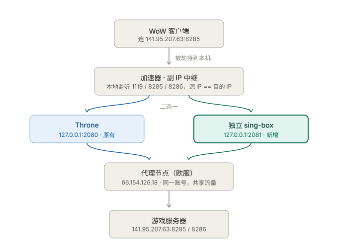

# Firestorm 自制加速器（py 版）

一套**不装驱动、不用 TUN、不注入进程、不用 Proxifier** 的单机 TCP 加速方案。
把游戏发往指定服务器 IP 的连接，悄悄改道走本地 SOCKS5 代理出网。

- 主程序：`firestorm_accel.py`（单文件，仅依赖 Python 标准库）
- 目标：`141.95.207.63`（Firestorm 私服魔兽的 logon + world 服务器）
- 效果：同主机实测，平均延迟 577ms → 485ms，抖动 σ 344ms → 139ms，最差单次 1483ms → 904ms

> **另有两个控制入口**，都用的是本文件里的同一批函数，逻辑不会跑偏：
>
> - `py\firestorm_tray.cmd` —— 托盘右键菜单（第十三节），适合日常一键起停
> - `gui\run-gui.cmd` —— 图形面板（原生窗口，tkinter），适合配置节点、看表格、
>   批量测速（见 `gui/README.md`）。

---

## 一、要解决的问题

游戏直连服务器时，链路是「中国电信 → 法国 OVH」。这条路的问题不是距离远（物理往返
~390ms 是光缆决定的，谁都改不了），而是**抖动和丢包**：实测直连平均 577ms、抖动 σ 344ms、
最差单次 1483ms。

TCP 在丢包时会重传 + 降窗，一次丢包造成的停顿会成倍放大成体感上的"卡住"。
所以目标不是"把 400ms 变成 40ms"，而是**把不稳定变成稳定**。

解决办法：让流量绕一圈，走一条抗丢包的隧道（Hysteria2 是 UDP/QUIC 封装，
自带前向纠错；VLESS-Reality 是纯 TCP）。实测绕行后的平均延迟和直连相当，
但抖动和最差情况大幅改善。

**难点在于：游戏不会乖乖听你的话去用代理。** 它硬编码直连 `141.95.207.63`。
所以要么 hook 它的 socket 调用（Proxifier / DLL 注入那一套），要么……

---

## 二、核心原理

### 2.1 一句话概括

**把游戏服务器的 IP 添加为本机的"副 IP"，让操作系统自己把发往该 IP 的流量回环到本机；
本机再起一个中继，把连接经 SOCKS5 交给代理节点，由节点那边发起真正的连接。**

```
游戏以为自己在连 141.95.207.63
其实是连到了本机上一个伪装成 141.95.207.63 的监听端口
中继再把连接转给代理，代理从境外出口去连真正的 141.95.207.63
```

### 2.2 为什么加个 IP 就能劫持？—— 路由表的最长前缀匹配

这是整个方案的地基，值得说清楚。

Windows（以及所有主流 TCP/IP 协议栈）在决定一个数据包往哪走时，遵循
**最长前缀匹配（longest prefix match）**：在所有匹配的路由条目里，选掩码最长的那条。

当 `141.95.207.63` 被配置为本机某个接口上的地址时，系统会**自动**为它生成一条
`141.95.207.63/32` 的本地路由（on-link）。`/32` 是可能的最长前缀，优先于任何
默认路由（`0.0.0.0/0`，掩码 0）。

于是任何进程 `connect("141.95.207.63", 8285)` 时：

1. 路由查询命中那条 `/32` 本地路由
2. 协议栈判定「目标就是本机自己」
3. 数据包**根本不发往网卡**，在内核里直接回环（loopback）
4. 投递给本机上监听 `141.95.207.63:8285` 的那个套接字

**判定劫持成功的铁证**：`netstat` 里会出现**源 IP 和目的 IP 完全相同**的连接。

```
TCP  141.95.207.63:50416  141.95.207.63:8286  ESTABLISHED  10484   <- 游戏进程
TCP  141.95.207.63:8286   141.95.207.63:50416 ESTABLISHED  38876   <- 中继进程
```

源和目的一样，说明包没出网卡。这就是"劫持成功"。

### 2.3 为什么副 IP 优先挂在回环伪接口上

`add_alias()` 的探测顺序是：

| 顺序 | 接口 | 命令 | 说明 |
|---|---|---|---|
| 1 | `Loopback Pseudo-Interface 1`（ifIndex 1） | `netsh interface ipv4 add address 1 <ip> 255.255.255.255` | **首选**，纯软件回环，无 ARP、无 MAC 层，副作用最小 |
| 2 | 默认路由所在物理网卡 | 同上 + `skipassource=true` | 兜底 |

挂物理网卡为什么要加 `skipassource=true`？因为不加的话，Windows 可能把这个地址当作
**可用于对外发包的源地址**，还可能触发地址冲突检测（DAD）和免费 ARP（GARP），
影响同网段的其它设备。加上 `skipassource=true` 告诉系统"别拿它当源地址"，
只保留"这是我本机地址"这一个含义 —— 我们要的就是后半句。

实际使用中第 1 种就能成功，副 IP 挂在回环接口上，干净利落。

### 2.4 为什么不能用 hosts 文件

因为**游戏只有登录阶段走域名**：

```
登录阶段： eu.sl.logon.firestorm-servers.com:1119   （走域名）
   ↓ 登录成功，拿到 realm（服务器）列表
世界服：  141.95.207.63:8285 / 8286                  （直接连 IP，无域名解析）
```

改 hosts 只能覆盖第一段。世界服连接是写死在客户端里的 IP，hosts 完全绕过 ——
**最关键的一跳反而没劫持到**。所以必须按 IP 下手。

（而且 logon 和 world 是**同一台机器的同一个 IP**，所以按 IP 劫持一次，全都覆盖了。）

### 2.5 为什么不用 TUN 模式

TUN 方案（Throne 自带的 / Clash Verge Rev / mihomo）要做三件事：

1. 安装虚拟网卡驱动（wintun）
2. 加一条比默认路由更具体的路由，把目标 IP 的流量抢到虚拟网卡上
3. 需要管理员权限，且**修改的是系统全局路由表**

对比：

| | TUN 方案 | 本方案 |
|---|---|---|
| 装驱动 | 需要（wintun） | **不需要** |
| 动全局路由表 | 需要 | **不需要**（只加一条 /32 本地地址） |
| 影响其他程序 | 取决于路由规则，容易误伤 | **零影响**，只有目标 IP 被改道 |
| 卸载/复原 | 卸载驱动 + 删路由 | `netsh ... delete address` 一行 |
| 权限 | 管理员 | 管理员（仅改地址时需要） |

### 2.6 为什么不用 Proxifier

Proxifier 走的是 LSP / WFP 层的进程级 socket 拦截。问题：

- 需要**逐个进程配规则**，容易漏配 —— 之前实测就是因为没给 WoW 加规则，
  默认走 Direct，等于完全没生效
- `Udp mode` 之类的选项容易配错，行为不直观
- 它是全局 hook，兼容性和稳定性风险更高
- 代理连接显示 3ms 是**假值**（驱动在本地直接应答 SYN），会让人误判"已经很快了"

本方案**不 hook 任何进程**，靠的是操作系统自身的路由行为，零侵入、可观测、可验证。

### 2.7 中继为什么必须经 SOCKS5 绕出去（而不是自己直连）

这是个容易踩的坑：如果中继进程直接 `connect("141.95.207.63", 8285)`，
**它自己也会命中那条 /32 本地路由** —— 于是连到自己，形成死循环。

所以必须把连接交给**别人**去发起。流程是：

```
中继 → connect 127.0.0.1:2080 (SOCKS5) → 请求「帮我连 141.95.207.63:8285」
                                      → 代理进程把请求发给代理专线节点
                                      → 节点从境外出口发起真实 TCP 连接
```

绕开的关键：**真实连接是由代理节点发起的**，它不在被劫持的主机上，
自然不受那条 /32 路由影响。

顺带一提，也考虑过"中继绑定出口网卡"（`SO_BINDTODEVICE` / `IP_UNICAST_IF`）来绕开，
但不行 —— 本地 /32 路由优先级最高，绑网卡也拦不住它；而且绑定物理网卡后连节点
反而可能出不去。走 SOCKS5 是最干净的解耦。

---

## 三、数据流



*图：同一条连接的两段路径 —— 游戏进程看到的是本机回环，游戏服务器看到的是从代理节点发起的连接。*

```
 ┌──────────────┐
 │  游戏进程     │  connect("141.95.207.63", 8285)
 └──────┬───────┘
        │
        │ ① 路由表最长前缀匹配 → 命中 /32 本地路由 → 判定"目标是自己"
        ▼
 ┌──────────────────────────────┐
 │  Windows 内核 TCP/IP 协议栈   │  数据包不出网卡，内部回环
 └──────┬───────────────────────┘
        │
        │ ② 投递给本机监听 141.95.207.63:8285 的套接字
        ▼
 ┌──────────────────────────────┐
 │  firestorm_accel.py          │  Relay.handle()
 │  监听 141.95.207.63:         │  每来一个连接，起一对管道线程
 │  1119 / 3724 / 8085 / 8086 / │
 │  8285 / 8286                 │
 └──────┬───────────────────────┘
        │
        │ ③ socks5_connect("141.95.207.63", 8285)
        ▼
 ┌──────────────────────────────┐
 │  SOCKS5 代理                 │  Throne 127.0.0.1:2080（固定）
 │                              │  或 独立 sing-box 127.0.0.1:<随机端口>
 └──────┬───────────────────────┘  端口每次启动重挑，见 runtime.json
        │
        │ ④ 封装进隧道（Hysteria2 UDP/QUIC 或 VLESS-Reality TCP）
        ▼
 ┌──────────────────────────────┐
 │  代理专线节点 (境外)        │  由节点出口发起真实 TCP 连接
 └──────┬───────────────────────┘
        │
        │ ⑤ 真实连接
        ▼
 ┌──────────────────────────────┐
 │  游戏服务器 141.95.207.63     │  真正的目的地
 └──────────────────────────────┘

 ⑥ 双向字节流原路返回，游戏进程毫无感知
```

**最精妙的地方**：起点和终点是**同一个 IP**，但走了两条完全不同的路径 ——
游戏进程看到的是本机回环，服务器看到的是从代理节点过来的连接。

---

## 四、工作内容（它具体做了哪几件事）

### 4.1 五件事，对应五个子命令

| 子命令 | 权限 | 干什么 |
|---|---|---|
| `setup` | **管理员** | 加副 IP + 检查代理连通性 + 起中继（前台运行，Ctrl+C 自动清理） |
| `run` | 普通 | 副 IP 已存在时，只起中继 |
| `teardown` | **管理员** | 摘掉副 IP，系统完全复原 |
| `status` | 普通 | 看副 IP 在不在、代理配的哪个 |
| `selftest` | 普通 | 绑 127.0.0.1 做端到端自测（不碰系统网络配置） |

### 4.2 `setup` 的详细步骤

```
1. is_admin()               → net session 判断是否提权，不是就报错退出
2. add_alias(TARGET_IP)     → 先试回环 ifIndex 1，失败试物理网卡 + skipassource
                             每次尝试后 sleep 0.4s，再用 alias_present() 复验
3. install_console_handler  → 注册 Windows 控制台事件回调（见 4.4）
4. socks5_ok()              → 试连一次目标，确认代理通了；不通只警告不退出
5. start_relay(IP, PORTS)   → 六个端口各起一个 ThreadingTCPServer
6. 主线程 sleep 循环        → 一直挂着，直到 Ctrl+C
7. finally: del_alias()     → 无论怎么退出，都摘掉副 IP
```

### 4.3 `Relay.handle()` —— 每个连接做什么

```python
def handle(self):
    port = self.server.server_address[1]        # 从监听端口反推要连的目标端口
    client = self.request                        # 游戏那一侧的 socket
    upstream = socks5_connect(TARGET_IP, port)   # 经代理连真实服务器
    # 起一个线程做 A→B，主线程做 B→A，形成双向管道
    threading.Thread(target=_pipe, args=(client, upstream), daemon=True).start()
    _pipe(upstream, client)
```

要点：

- **端口即路由**：中继不需要理解任何游戏协议，只要知道"这个连接是从哪个端口进来的"，
  就去连目标的同一个端口。所以 `:8285` 进 → 连 `:8285` 出，一一对应。
- **双向转发**：两个方向各一个 `_pipe()`，64KB 块搬运。任何一侧关闭就 `shutdown(SHUT_WR)`
  通知对端，这是标准的 TCP 半关闭处理，不会把连接粗暴掐断。
- **一个连接一对线程**：`ThreadingTCPServer` + `daemon_threads`，游戏连接数不多，够用。

### 4.4 为什么要有 `install_console_handler`

这是防"翻车"的关键。用户很可能直接点窗口右上角的 X 关掉，而不是 Ctrl+C。
如果副 IP 没被摘掉，**残留的 `/32` 路由会让游戏彻底连不上服务器**
（流量被导入本机但没人监听），而且用户一脸茫然不知道发生了什么。

所以注册 `SetConsoleCtrlHandler`，在收到这些事件时也执行清理：

| 事件 | 值 | 场景 |
|---|---|---|
| CTRL_C_EVENT | 0 | Ctrl+C |
| CTRL_BREAK_EVENT | 1 | Ctrl+Break |
| CTRL_CLOSE_EVENT | 2 | **点 X 关窗口** |
| CTRL_LOGOFF_EVENT | 5 | 注销 |
| CTRL_SHUTDOWN_EVENT | 6 | 关机 |

清理时会遍历 `USED_IFACE` 和 `LOOPBACK_IFACE` 两个接口都删一遍，确保删干净。

### 4.5 `del_alias()` 的兜底策略

删除比添加更容易失败（比如记错了当初挂在哪个接口上）。所以 `del_alias()` 是三层兜底：

1. 删已知接口：`{LOOPBACK_IFACE, IFACE, detect_iface()}`
2. 读 `netsh interface ipv4 show interfaces` 拿到**所有**接口索引，逐个删
3. 最后用 `alias_present()` 复验，还在就打印警告让用户手动查

宁可多删几次（删不存在的地址只是报个错，无害），也不能漏。

---

## 五、代码结构

单文件 `firestorm_accel.py`，约 430 行。分组说明：

### 参数区（顶部）

```python
TARGET_IP   = "141.95.207.63"           # 要劫持的目标 IP
PORTS       = [1119, 8285, 8286, 3724, 8085, 8086]
SOCKS_HOST  = "127.0.0.1"               # 上游代理
SOCKS_PORT  = 2080                      # 默认 Throne；独立 sing-box 用随机端口
                                        #   （由 --socks / setup 覆盖，别改这里）
SOCKS_USER  = None                      # 代理需要认证时填
SOCKS_PASS  = None
LOG_PATH    = <同目录>/firestorm_accel.log
```

端口是按用途列的：`1119` 是 logon，`8285/8286` 是 world，`3724`/`8085`/`8086`
是备用/其它服务。多监听几个的成本几乎为零，但能避免"某个端口没映射到导致掉线"。

### 工具函数

| 函数 | 作用 | 备注 |
|---|---|---|
| `LOG(*a)` | 同时打控制台 + 追加日志文件 | 提权窗口的输出一闪而过，日志文件是唯一可回溯的记录 |
| `run(cmd)` | 执行系统命令，返回 `(rc, 输出)` | **依次尝试 utf-8 / gbk / mbcs / latin1 解码** —— 中文 Windows 的 `netsh` 输出是 GBK |
| `is_admin()` | `net session` 返回 0 即已提权 | 比查 SID 简单可靠 |
| `detect_iface()` | PowerShell 查默认路由的 `ifIndex` | 取 RouteMetric 最小的那条 |
| `alias_present(ip)` | `SO_REUSEADDR` + `bind((ip, 0))` | 能绑上就说明该 IP 在本机。**不需要管理员**，所以 `status` 谁都能跑 |

### SOCKS5 客户端

| 函数 | 作用 |
|---|---|
| `_recvn(sock, n)` | 精确读 n 字节。SOCKS5 是二进制协议，`recv()` 可能短读，必须循环凑齐 |
| `socks5_connect(host, port)` | 完整握手：版本协商 → 可选用户名密码认证 → CONNECT 请求 → 解析应答（含域名/IPv6 三种 ATYP 分支） |

握手成功后会把超时设为 `None`（阻塞模式），因为游戏连接是长连接，不能有 socket 超时。

### 中继

| 类/函数 | 作用 |
|---|---|
| `_pipe(src, dst)` | 单向搬运 64KB 块，结束时 `shutdown(SHUT_WR)` |
| `Relay(BaseRequestHandler)` | 每个入站连接的处理逻辑 |
| `Server(ThreadingTCPServer)` | `allow_reuse_address = True`（**关键**，见下）、`daemon_threads = True` |
| `start_relay(bind_ip, ports)` | 逐端口建监听，单个端口失败只警告不中断其它端口 |

> `allow_reuse_address = True` 为什么关键：副 IP 可能因为上次没清理干净而"看起来存在"，
> 这时 bind 会撞上残留的监听或 TIME_WAIT。开了 `SO_REUSEADDR` 能大幅提高成功率。

### 网络配置

| 函数 | 作用 |
|---|---|
| `add_alias(ip)` | 加副 IP，回环优先、物理网卡兜底，每次尝试后复验 |
| `del_alias(ip)` | 删副 IP，三层兜底 |
| `install_console_handler(ip)` | 注册控制台事件回调做兜底清理 |

### 子命令

`cmd_setup` / `cmd_run` / `cmd_teardown` / `cmd_status` / `cmd_selftest`，
由 `main()` 里的字典分发。

---

## 六、命令行用法

```bash
# 基本用法（管理员终端）
python firestorm_accel.py setup

# 指定走独立 sing-box 而不是 Throne
# 端口是随机的，先问 portof.py 要（见 docs/独立sing-box使用说明.md 第 3 节）
python ..\Sing-box\portof.py socks
python firestorm_accel.py setup --socks 127.0.0.1:<上一步输出的端口>

# 看状态
python firestorm_accel.py status

# 摘掉副 IP
python firestorm_accel.py teardown

# 端到端自测（不需要管理员，不碰系统配置）
python firestorm_accel.py selftest
```

| 参数 | 默认值 | 说明 |
|---|---|---|
| `--target` | `141.95.207.63` | 要劫持的目标服务器 IP |
| `--ports` | `1119,8285,8286,3724,8085,8086` | 逗号分隔的端口列表 |
| `--socks` | `127.0.0.1:2080` | 上游 SOCKS5 地址 |
| `--iface` | 自动探测 | 强制指定挂副 IP 的网卡索引 |

### 配套的 .cmd 启动器

| 文件 | 作用 |
|---|---|
| `run_accel.cmd` | 自提权 → `setup`（走 Throne 2080） |
| `run_accel_singbox.cmd` | 自提权 → 先读该 profile 的 runtime 文件拿随机端口 → `setup --socks 127.0.0.1:<端口>`（加 `backup` 走备实例） |
| `switch_upstream.cmd` | 自提权 → 停旧中继 → 换上游（无参=主实例，`backup`=备实例，`throne`=切回 2080） |
| `stop_accel.cmd` | 自提权 → `teardown` → 再 `status` 确认 |
| `firestorm_tray.cmd` | 启动托盘控制台（见第十三节） |

这些脚本都用 `%~dp0` 自动定位自身路径，`PY` 找不到就回退到 PATH 里的 `python`，
所以整个目录随便挪位置都不会坏。

> ⚠️ **这几个 `.cmd` 是 GBK + CRLF 存的，且刻意不写 `chcp`。**
> 原因见 `docs/独立sing-box使用说明.md` 第 5.6 节 —— 存成 UTF-8 或改行尾会让
> cmd 解析错位，报一堆"不是内部或外部命令"。别让编辑器"另存为 UTF-8"。

---

## 七、selftest 在没有管理员权限时怎么测

`setup` 需要管理员（改地址），但**验证逻辑本身不需要**。`selftest` 的做法是：

1. 把中继绑在 `127.0.0.1`（而不是副 IP）的 `PORTS[0]`（1119）上 ——
   绑回环不要权限
2. 本机连一下这个端口
3. 观察链路是否打通：本进程 → 中继 → SOCKS5 → 真实服务器

这样能在不碰任何系统网络配置的前提下，确认「SOCKS5 通不通、中继代码对不对、
目标端口对不对」这三件事。定位问题时先跑 `selftest`，能快速区分是
"中继/代理的问题"还是"副 IP 劫持的问题"。

---

## 八、实测数据


*图：加速前后四项指标对比。最低值几乎没动（那是物理下限），被干掉的是最差单次和抖动。*

同主机，到 `141.95.207.63:80` 的应用层首字节往返（**注意：不要看 SOCKS CONNECT
握手耗时，那是假值** —— sing-box 对 QUIC 出站会乐观应答 CONNECT，恒为 2ms）：

| 场景 | min | avg | max | 抖动 σ | 失败 |
|---|---|---|---|---|---|
| 加速前 · 直连 | 404 | 577 | 1483 | 344 | 0/15 |
| 加速后 · 经隧道 | 385 | 485 | **904** | **139** | **0/90** |

分项看：

- **最低值几乎没变**（404 → 385）—— 因为这是中法光缆的物理下限，改不了
- **最差单次 -39%、抖动 -60%** —— 这才是加速器真正的价值：消灭 TCP 重传尖峰
- **0/90 失败** —— 稳定性提升

不同代理出口的对比（30 轮交替，每个节点各 30 个样本）：

| 出口 | min | p50 | p90 | avg | max | 抖动 σ |
|---|---|---|---|---|---|---|
| **hysteria2**（配置默认） | 384 | 391 | **616** | **467** | **897** | **141** |
| vless-reality | 378 | 397 | 859 | 514 | 1583 | 284 |

**结论：用 hysteria2 —— 也就是 config.json 里的默认节点。** 两者的最低延迟几乎
相同（378 / 384，都是物理下限），但 vless-reality 的抖动是它的**两倍**、
最差单次几乎**翻倍**。

原因是协议层次：**vless-reality 是 TCP over TCP** —— 外层隧道丢一个包，内层游戏的
TCP 会跟着重传，两层重传互相放大；而 hysteria2 基于 QUIC/UDP，自带前向纠错和
专为劣质链路设计的拥塞控制，**抗丢包正是它被设计出来要解决的问题**。

> ⚠️ **这个结论经历过一次反转，过程值得记一笔。** 最早的 18 轮小样本测试显示
> vless-reality 抖动更小（σ 72 vs 105），我据此写过"推荐用 vless"；后来 12 轮
> 又是 hy2 更好；最终 30 轮复测 hy2 全面胜出（σ 141 vs 284）。
> **跨境延迟测量的噪声极大，一两轮的结果根本不足以定论，必须靠足够样本量。**

---

## 九、已知限制

1. **只劫持 TCP。** 中继只监听 TCP 端口。如果游戏的某些功能走 UDP（语音、部分实时同步），
   这些流量不过隧道；而且因为副 IP 存在，它们可能**直连不通**。
   目前实测未见异常，若出现"语音不可用"之类的问题，原因在此。
2. **副 IP 是全局生效的。** 开启期间，本机**任何**程序访问 `141.95.207.63`
   都会被劫持。必须用 `stop_accel.cmd` 或 `teardown` 清理。
3. **强依赖上游代理。** 如果 Throne / sing-box 挂了，中继建不上上游连接，
   游戏会表现为**连不上服务器**（而不是自动回退直连）。
   `setup` 里的 `socks5_ok()` 只是为了提前警告，并不会自动切换。
4. **需要管理员权限** —— 仅 `setup` / `teardown` 需要，运行中的中继不需要。
5. **不适合高并发**。`ThreadingTCPServer` 一连接一线程，游戏场景（几个到几十个连接）
   完全够用，但不适合当通用代理用。

---

## 十、故障排查

| 现象 | 原因 | 处理 |
|---|---|---|
| `副 IP 添加失败` | 没提权 / 网卡索引不对 | 用管理员终端；或 `--iface <索引>` 指定 |
| `SOCKS5 连不上` | 上游代理没开 | 先启动 Throne 或独立 sing-box |
| 游戏连不上服务器 | 副 IP 残留，但中继没在跑 | 跑 `stop_accel.cmd` 清理 |
| 游戏连不上，副 IP 也在 | 上游代理挂了 | 查 Throne 2080 是否在听；若走 sing-box，跑 `Sing-box\portof.py socks` 拿端口再 `netstat` 核 |
| 延迟没改善 | 看的是 CONNECT 握手（假值） | 用应用层往返测，见第八节 |
| `status` 显示 OFF 但游戏还是连不上 | 有别的残留 | `netsh interface ipv4 show addresses` 手工查 |

### 快速自检顺序

```
1. python firestorm_accel.py status      → 副 IP 在不在
2. netstat -ano | findstr 38876          → 中继进程在不在监听
3. python firestorm_accel.py selftest    → 中继 + 代理链路通不通
4. netstat -ano | findstr 141.95.207.63  → 源 IP == 目的 IP 就说明劫持生效
```

---

## 十一、文件清单

```
py/
├─ firestorm_accel.py        加速器主程序（433 行，仅标准库）
├─ firestorm_tray.py         托盘控制台（~800 行，零依赖 Win32）
├─ firestorm_tray.cmd        启动托盘（会请求一次 UAC）
├─ run_accel.cmd             启动加速器：走 Throne 127.0.0.1:2080
├─ run_accel_singbox.cmd     启动加速器：走独立 sing-box（端口现读；加 backup 走备实例）
├─ switch_upstream.cmd       切换上游（杀旧中继 → 清副 IP → 用新上游重启）
├─ stop_accel.cmd            停止加速器：摘除副 IP
├─ firestorm_accel.log       加速器日志（提权窗口的输出也会记到这里）
├─ tray.log                  托盘日志
└─ README.md                 本文件
```

相关目录：

- `../Sing-box/` —— 独立 sing-box 实例（与 Throne 隔离的代理出口）
  - `start_singbox.py` / `stop_singbox.py` —— 随机端口启停（写 / 读 `runtime.json`）
  - `portof.py` —— 给 `.cmd` 查当前随机端口的单行输出小程序
  - `runtime.json` —— 本次运行的端口 + PID（**不要提交**，含凭据的
    `config.runtime.json` 同样已进 `.gitignore`）
- `../docs/` —— 效果验证报告、独立 sing-box 使用说明
- `../c/` —— 计划中的 C 版（无 Python 依赖，单 exe，Winsock hook 方向）

---

## 十二、为什么还要有 c/ 版本

py 版是个**可用且已验证**的原型，优点是改起来快、逻辑透明、排查方便。
但如果要长期开机使用，它的短板是：

- 需要 Python 运行时
- 每连接一对线程，资源占用不够省
- 加固版应该做成单 exe、常驻托盘、自动检测游戏进程启停

C 版的目标就是把 py 版这套已验证的原理，做成零依赖、可直接分发的实现。
原理不变，只是换个载具。

---

## 十三、托盘控制台（firestorm_tray.py）

一个常驻系统托盘的迷你控制面板，用来替代"记一堆 .cmd 文件名 + 每次双击"的用法。

### 13.1 它管什么

| 菜单项 | 作用 |
|---|---|
| 顶部状态行 | 当前完整状态（只读）：运行情况 + 上游节点 + 游戏是否在线 |
| 启动 / 停止加速器 | 起停中继；停止时会**顺带清理副 IP**（强杀不会触发进程内的回调，必须补这一刀） |
| sing-box 实例 → 启动/停止主实例 | 随机端口起停主实例，菜单里直接显示当前入口端口 |
| sing-box 实例 → 启动/停止备实例 | 同上，备实例 |
| 上游节点 → Throne (2080) | 切换加速器上游，自动"停止旧中继 → 清理副 IP → 用新上游重启" |
| 上游节点 → 主/备 sing-box (端口) | 端口是**动态**的，还会带上当前节点名；实例没跑时该项置灰 |
| 开机自动启动 | 用 `schtasks /RL HIGHEST` 建登录计划任务（托盘要改网络配置，必须最高权限） |
| 查看日志 / 打开目录 | 方便排查 |
| 退出 | 清掉托盘图标 |

菜单实际长这样（两实例都在跑时）：

```
运行中  |  上游: Throne  |  游戏在线
─────────────────────────────
停止加速器
─────────────────────────────
sing-box 实例
   停止主实例  (入口 55932)
   停止备实例  (入口 54619)
─────────────────────────────
上游节点
   Throne  (2080)
   主实例 sing-box  (55932，qiniu-0001)
   备实例 sing-box  (54619，hy2-va1)
─────────────────────────────
开机自动启动 / 查看日志 / 打开程序目录 / 退出
```

**托盘图标颜色就是状态**，扫一眼就知道：

| 颜色 | 含义 |
|---|---|
| 绿色 | 加速器运行中（副 IP 正常 + 中继在监听） |
| 红色 | **异常**：副 IP 挂着但中继没起来 —— 此时游戏流量是黑洞，点"停止加速器"即可清理 |
| 黄色 | 只有 sing-box 在跑（两个实例任一），加速器已停 |
| 灰色 | 都没跑 |

### 13.2 为什么是手写的 Win32

本机 **pypi 不可达**（`pip install pystray pillow` 报 `No matching distribution found`），
装不了任何托盘库。索性只用标准库 + `ctypes` 直调 Win32，反而更符合"单文件、零依赖"
的定位。用到的 API：`RegisterClassW` / `CreateWindowExW`（隐藏窗口）、
`Shell_NotifyIconW`（托盘图标）、`CreatePopupMenu` + `TrackPopupMenu`（右键菜单）、
`CreateIconIndirect`（动态生成图标）、`GetMessageW` 消息循环。

图标不是资源文件，是**用 GDI 现场画的一个实心圆点**（`CreateDIBSection` 填像素 +
`CreateBitmap` 做掩码 + `CreateIconIndirect`），所以想换颜色只要改 RGB。

### 13.3 启动

```cmd
py\firestorm_tray.cmd       双击，会弹一次 UAC（托盘要改网络配置，必须提权）
```

调试时可以用 `python firestorm_tray.py --no-elevate --console`，不提权、保留控制台。

### 13.4 踩过的坑

**① `ctypes.wintypes` 的 `LPARAM` 在 64 位下是 32 位的。**

窗口过程用 `WNDPROC = WINFUNCTYPE(LRESULT, HWND, UINT, wt.WPARAM, wt.LPARAM)` 定义时，
某些消息的 `lParam` 会超过 32 位，直接炸：

```
ctypes.ArgumentError: argument 4: OverflowError: int too long to convert
```

而且它是在**回调内部**抛的，异常被 ctypes 吞掉只打印一行 `Exception ignored`，
窗口表面看着还能用，实际上消息处理是坏的 —— 这种最难查。

正解：别用 `wt.WPARAM` / `wt.LPARAM`，改用 `c_size_t` / `c_ssize_t`（对齐
Windows 的 `UINT_PTR` / `LONG_PTR`）。同理，所有返回**句柄**的 API 都要显式声明
`restype`，否则 64 位句柄会被截成 32 位。

**② `tasklist /FI` 的过滤器在本机不可靠。**

`tasklist /FI "IMAGENAME eq Wow*.exe"` 不支持通配符，`/FI "PID eq 1234"` 也出现过
返回空（害我误判过一次"中继已死"）。正解：用 `CreateToolhelp32Snapshot`
枚举进程自己匹配 —— 顺带还快了两个数量级，`tasklist` 全量要 ~900ms，
Toolhelp 只要 ~10ms。**判断进程存活一律用 `netstat` 反查端口，不要信 tasklist。**

**③ 状态探测要分两档。**

`snapshot(full=False)` 只做 4 次本地探测（bind 测副 IP、bind 测中继监听、
connect 测 Throne 端口、connect 测 sing-box 的当前随机端口），**~7ms**，可以放心每 4 秒刷一次；
`snapshot(full=True)` 才跑 `netstat` + 进程枚举拿上游和游戏状态，**~270ms**，
只在开右键菜单时用。不分开的话，定时刷新会把消息循环卡住，右键菜单点下去要等一秒才弹出来。

**④ `schtasks` 的结果要缓存。**

右键菜单里要显示"开机自启"的勾选状态，而 `schtasks /Query` 一次要 100~300ms。
不缓存的话每次开菜单都白等。加了 15 秒的 TTL 缓存。

**⑤ 上游端口是随机的，所以"哪个上游"不能靠比对常量。**

原来 `PORT_SINGBOX = 2081` 是个常量，判断"当前上游是谁"就是比端口。
改成随机端口后这套就废了。现在的做法：

- 一切端口现读 runtime 文件（`sb_socks_port(profile)`），不缓存、不写死；
- 判"中继挂在谁身上"改成**取中继那条到 `127.0.0.1` 的 `ESTABLISHED` 连接的远端口**
  （`accel_upstream()`），再拿 `known_upstream_ports()`（Throne + 两个实例）去认。
  中继对外的连接目标是游戏服务器 IP，不是回环，不会误判 ——
  所以这个办法对"以后再加第四个上游"也是通的；
- `upstream_name(port)` 负责把端口翻译成人话，认不出来就显示 `未知端口 N`；
- sing-box 起停**不自己拼命令行**，而是转手调 `Sing-box/start_singbox.py --profile X` /
  `stop_singbox.py --profile X`。挑端口、剥注释、生成运行时配置的逻辑只存在一份，
  托盘不重复实现（否则两边迟早不一致）。

**⑥ 状态文件绝不能跨 profile 回退。**

第一版 `sb_runtime(profile)` 写成"先读自己的 runtime 文件，读不到就退到
`runtime.json`"——本意是兼容历史文件名，结果**备实例没在跑时，它读到了主实例的
状态文件**，于是 `sb_running("backup")` 返回 `True`、端口显示成主实例的 28658，
点"启动备实例"还会说"已在运行"。

这类 bug 很隐蔽：单实例时完全正常，加第二个实例才炸。
**修法就是不做任何回退** —— `sb_state_path(profile)` 已经让 main 指向
`runtime.json` 了，回退逻辑纯属多余。
`portof.py` 里有同样一处，一并修了。

经验：**多实例系统的状态隔离，宁可能读到空、也不能读到别人的。**
判断"实例在跑吗"永远是"读文件 + 探端口"两步，只看文件会被残留骗。

**⑦ 随机端口要避开系统预留段，不然 bind 会 access denied。**

第一版只在 `20000–60000` 里 `random.randint` + `bind` 试，能用但会踩坑：
Windows 上 Hyper-V / WSL / Docker 会通过 `netsh` **整块预留**端口段，
落在预留块里的端口 `bind()` 抛的是 **`WSAEACCES`（access denied）**，
**不是** `WSAEADDRINUSE`。现象就是"随机挑端口偶尔莫名失败"，很难往预留段上想。

现在的做法（`start_singbox.py`）：

- 启动时先跑一次 `netsh int ipv4 show excludedportrange protocol=tcp` 和
  `... protocol=udp`，**两边的段取并集**（inbound 的 mixed 同时占 TCP+UDP）；
- 解析只取数字，用正则 `\s*(\d{1,5})\s+(\d{1,5})\s*\S*\s*$`。末尾那个 `\S*`
  是必需的 —— 管理员永久预留的段会在行尾多个 `*`，不放过它就会漏掉一整段。
  netsh 输出是控制台代码页（简中 936），用 `cp936` + `errors="replace"` 解，
  乱码不影响取数；
- 结果缓存一次，别每次挑端口都去起子进程；
- **默认范围抬到 `50000–65535`**（15536 个候选）。低位段全是各种软件的固定端口，
  大数段几乎不会被人认领，排查时也一眼能认出"这是随机出来的"；
- 高位段挑不到（`pick_port` 返回 `None`）**自动退到 `20000–65535`**，
  所以 `pick_port` 的返回值得允许 `None`，不能像原来那样直接 `raise`。
- 想手动看当前预留段：`python Sing-box\start_singbox.py --show-excluded`。

